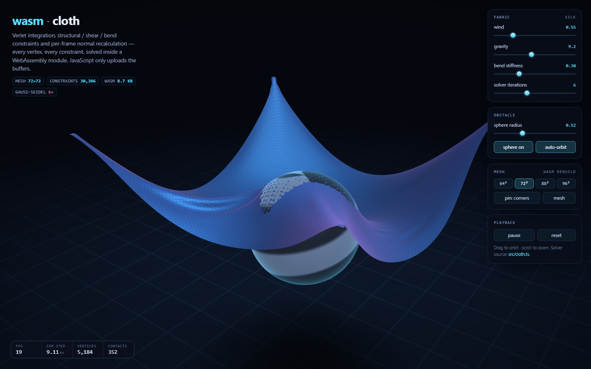

# wasm-cloth

A 5,184-vertex cloth that folds, ripples and drapes over a rotating sphere — with the
**entire simulation living in an 8.7 KB WebAssembly module**. Verlet integration,
structural/shear/bend constraint solving, collision resolution and per-frame normal
recalculation all happen inside wasm. JavaScript never touches a vertex; it uploads the
exported memory buffers to WebGL and draws.

**[→ live demo](https://nwfella.github.io/wasm-cloth/)** · drag to orbit · scroll to zoom



## What it does

- **72 × 72 vertex grid** (5,184 vertices, 10,082 triangles) — rebuildable from the UI at
  64², 72², 88² and 96², which re-initialises the module's mesh, constraints and indices.
- **30,386 distance constraints** in three families, each with its own stiffness knob:
  10,224 structural, 10,082 shear (both cell diagonals) and 10,080 bend (skip-one neighbours).
- **Verlet integration** with a fixed 1/60 s timestep, accumulator and substep cap, so
  motion stays stable when the frame rate is not.
- **Collision against a moving sphere** (radial projection, 0..400 vertices in contact per
  frame) plus a floor plane with contact friction.
- **Dynamic normals**: every triangle's cross product is accumulated per-vertex (area
  weighted) and normalised inside wasm each step, so the lighting tracks every fold.
- **Two-sided fabric shading** with half-lambert wrap, sheen, fresnel rim and a fine weave.

## Architecture

```
src/cloth.ts  ──asc──▶  build/cloth.wasm (8.7 KB)  ──base64──▶  index.html
     │                        │                                     │
  AssemblyScript          WebAssembly                    single file, opened
  (source of truth)    (imports: env.abort only)          over file://, no server
```

The page carries the module as base64 and instantiates it from bytes: a `file://` page has
origin `null`, so `fetch()` of a sibling `.wasm` is blocked by CORS. One HTTP request, or
zero — it works the same offline.

### The module's contract

| export | purpose |
| --- | --- |
| `init(cols, rows, spacing, pinY)` | build grid, constraints, indices; clamps to 96² |
| `step(dt, t)` | integrate → solve structural/shear/bend → collide → recompute normals |
| `setPhysics(g, drag, wind, freq, iters, ks, ksh, kb, floorY)` | solver + forcing parameters |
| `setSphere(x, y, z, r, on)` | collider pose; the renderer reads the same value it sends |
| `setPinMode(mode)` | 4 pinned corner blocks, or the full border ring |
| `posPtr() normPtr() uvPtr() idxPtr()` | byte offsets into exported memory |
| `constraintError() nearestToSphere() extentY() getHitCount()` | diagnostics the gate asserts on |
| `poke(i, x, y, z)` | teleport one vertex (position *and* previous) — used by the closed-form test |

Positions and normals are interleaved at stride 4 (`x, y, z, pad`) in one array each, so a
WebGL attribute is a single upload with `stride = 16` and the solver walks memory
sequentially.

## Performance, measured

The first working version took **27 ms per step** for a 72² sheet — 60 % over a frame
budget. Two changes, both measured with a throwaway Node bench:

| version | ms/step | why |
| --- | --- | --- |
| typed arrays, 3 planar buffers | 27.0 | `arr[i]` in AssemblyScript compiles to a bounds-checked **function call** (`Float32Array#__get`) — ~20 per constraint |
| raw `load`/`store` on pointers | 7.1 | one wasm load/store per element access |
| + interleaved stride-4 layout | 7.0 | three 20 KB arrays were touched per constraint; one stream is sequential |
| + constant-mass divide removal | 6.9–7.1 | inverse mass is exactly 0 or 1, so `wi/ws` is a literal |

Shipped step cost: **~7 ms** for 5,184 vertices, 30,386 constraints and 6 solver iterations,
with normal recomputation and collision included. `node scripts/verify_wasm.js` prints the
number it measures on your machine and fails the build if a step stops fitting a 60 fps frame.

Removing the wind trigonometry saved 0.34 ms and removing the collision passes saved
nothing — the constraint sweeps were everything, which is the opposite of what the profile
looked like from reading the code.

## Controls

| control | effect |
| --- | --- |
| wind / gravity | forcing amplitude and acceleration |
| bend stiffness | fold sharpness (0 = crumples, 1 = board-stiff) |
| solver iterations | Gauss–Seidel passes per step: quality vs milliseconds |
| sphere radius | collider size (also changes the drape pocket) |
| mesh 64²–96² | rebuilds the whole mesh inside wasm |
| pin corners / frame | four anchored corner blocks, or the full border ring |
| mesh overlay | wireframe of every structural edge |

## Build and verify

```bash
npm install                 # assemblyscript (the only dependency, dev-only)
npm run build               # compile wasm + inline it into index.html
npm run verify              # tier 1: the physics, headless, through the module's exports
npm run verify:browser      # tier 2: real Chrome via CDP — pixels, controls, layout
npm run verify:all          # all three, in order
```

Both gates test the module **embedded in `index.html`**, not `build/cloth.wasm`, and the
first thing they assert is that those bytes are identical — so the artifact that ships is
the artifact under test.

`verify` (38 assertions) checks topology against closed-form counts, absence of NaN,
bit-identical determinism, immobile anchors, zero interpenetration, unit-length normals that
change per step, a **perturbed vertex returning to its analytic equilibrium** (border-pinned
sheet, zero gravity, `poke` → settles within 0.2 % of the plane), error monotonicity across
iterations 1→12, a stability sweep over the whole parameter matrix, and the ms/step budget.

`verify:browser` (42 assertions) boots real headless Chrome and asserts the WebGL2 context,
the requestAnimationFrame loop advancing, canvas ink fraction and shading gradient, the
wireframe overlay changing >2 % of pixels, every slider moving its readout *and* the wasm
state together, pause freezing the simulation clock, pointer-drag orbit, wheel zoom, and
zero overflow plus an unclipped stat strip at 320/390/1024 px. It also writes the
screenshots in this README.

Two defects these gates caught that no amount of reading the code would have:

- **All four shader programs shared one uniform table.** `WebGLProgram` stringifies to
  `"[object WebGLProgram]"`, so keying an object by the program object made every
  `uniform*` call target the wrong program — silently, rendering a black scene.
- **`iterations = 1` diverged to NaN** in ~200 steps. A position-based solver at a coarse
  timestep cannot keep up with gravity, and stretch feeds velocity. The fix is a per-step
  displacement clamp, which costs nothing visually (real motion is orders of magnitude
  slower) and removes the failure mode entirely.

## Limitations

- No cloth self-collision, so a fold can pass through another fold.
- The sphere is a kinematic obstacle: it pushes the fabric, the fabric does not push back.
- Single-precision floats and no long-run conservation guarantee — it is a demo, not a
  cloth CAD kernel.
- FPS numbers in the committed screenshots come from Chrome's software rasteriser
  (SwiftShader); the wasm step time is representative, the frame rate is not.

## License

MIT.
