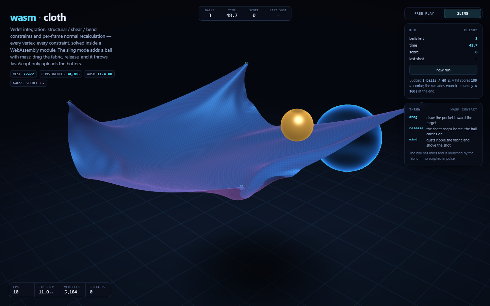
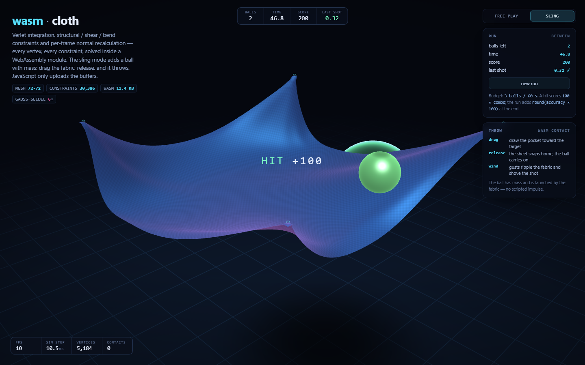

# wasm-cloth

A 5,184-vertex cloth that folds, ripples and drapes over a rotating sphere — with the
**entire simulation living in an 11.4 KB WebAssembly module**. Verlet integration,
structural/shear/bend constraint solving, collision resolution and per-frame normal
recalculation all happen inside wasm. JavaScript never touches a vertex; it uploads the
exported memory buffers to WebGL and draws.

The same module also runs a **real-time sport**: a ball with mass that the fabric launches.
It is not a scripted animation — the ball is a dynamic body with its own integrator, and
every launch is momentum it took from the sheet. There is no launch impulse anywhere in the
source.

**[→ live demo](https://nwfella.github.io/wasm-cloth/)** · free play: drag to orbit, scroll to zoom ·
sling: drag the fabric toward the target and let go


## The sport: Sling

A second mode in the same page, on the same solver — free play is one click away and its
gate still passes unchanged.

The ball drops from a fixed point into the pocket the hammock makes under its own weight.
You press on the fabric and drag: all four corner anchors move by your draw vector plus a
shared downward pull, so the pocket travels and deepens. Hold for a second and the draw
saturates. Release, and the anchors snap home over 233 ms — **the sheet whips out from under
the ball and the ball carries its momentum away**. Aim is the draw direction, power is the
draw distance, and the target glides along z so you have to lead it.

| | |
| --- | --- |
| budget | 3 balls, 60 s |
| a hit | `100 × combo`, combo counts consecutive hits |
| the run | adds `round(accuracy × 100)` on top of the hit points |
| shown | balls left, clock, score, and the last shot's distance to the target centre |





Scoring is decided inside wasm (`scored()`), so the HUD and the gate read one number, and a
graze exactly on the target surface is a **miss** — the comparison carries an explicit
1 um margin rather than a bare `<` on squared f32 distances, which made a dead-on graze a
coin flip.

## Momentum exchange, measured

The ball has mass, its own semi-implicit integrator, air drag, a speed clamp and a floor
bounce. Contact is resolved **in both directions**, split by inverse mass:

1. the penetration is divided between the fabric and the ball — the sheet takes `M/(M+1)`, the
   ball `1/(M+1)`;
2. the ball's velocity is then rebuilt from the displacement it just received, times
   `1 + restitution`.

That second step is the part that took the work. The obvious implementation — sample the
contact vertex's velocity, apply an equal-and-opposite impulse — **does not work on a
position-based cloth**: the solver reports its own indentation-restoring correction as motion,
so a ball resting on a sheet is pushed upward every step by the sheet's fight with its own
dent. Measured: a 50 mm perpetual bob at KE 0.9 J that never decayed, and a 6 u/s kick out of
any ball that merely touched the fabric. Two intermediate fixes (mirroring the projection into
the previous position; snapshotting the pre-solve velocity) reduced the drift to 47 mm and
then made it worse, because the pollution is structural, not numerical. Deriving the ball's
velocity from its **own** correction removes the velocity source entirely.

Shipped contact constants, all gated rather than hoped for: `BALL_SUB 3` sub-steps against
tunnelling, `BALL_SKIN 0.006`, `BALL_QDAMP 0.90`, `BALL_GRIP 0.60` / `BALL_FRICTION 0.55`
(a frictionless ball creeps ~5 mm per hundred steps down an asymmetric pocket and never
comes to rest), restitution 0.25.

`npm run verify` asserts, through the module's exports only:

| claim | measured |
| --- | --- |
| a ball at rest on a taut sheet stays within 1 mm for 300 steps | **0.031 mm** worst excursion |
| no input, no wind: kinetic energy never rises more than 2 % over 600 steps | **4.09e-4 -> 4.18e-4 J** |
| a dropped ball's first bounce is lower than its drop height | dropped 1.600 -> **rebound apex 1.059** |
| 1200 steps at every iteration count 2..12: no NaN, bounded | clean, ball peak **5.13 u/s** |
| two identical shots are bit-identical | **max delta 0** over 5,184 vertices + the ball |
| `scored()` is 1 only strictly inside the target | inside 1, surface **0**, outside 0 |
| taut and slack sheets launch at measurably different speeds | taut(ks 1.0) **5.98 u/s** vs slack(ks 0.25) **5.24 u/s**, 12.4 % apart |
| draw depth is a real power lever | draw 0.35 -> **3.46 u/s** (apex 0.60); draw 0.60 -> **5.98 u/s** (apex 1.01) |
| a disabled ball changes nothing | **max delta 0** over the whole cloth — free play is untouched |

If the exchange had turned out mushy or explosive, the plan was to damp it and gate the
damping constant instead of loosening the energy bound. It did not come to that: the failures
were all in the velocity *source*, not in the exchange, and the shipped contact adds no energy.

## What it does

- **72 × 72 vertex grid** (5,184 vertices, 10,082 triangles) — rebuildable from the UI at
  64², 72², 88² and 96², which re-initialises the module's mesh, constraints and indices.
- **30,386 distance constraints** in three families, each with its own stiffness knob:
  10,224 structural, 10,082 shear (both cell diagonals) and 10,080 bend (skip-one neighbours).
- **Verlet integration** with a fixed 1/60 s timestep, accumulator and substep cap, so
  motion stays stable when the frame rate is not.
- **Collision against a moving sphere** (radial projection, 0..400 vertices in contact per
  frame) plus a floor plane with contact friction.
- **Dynamic normals**: every triangle's cross product is accumulated per-vertex (area
  weighted) and normalised inside wasm each step, so the lighting tracks every fold.
- **Two-sided fabric shading** with half-lambert wrap, sheen, fresnel rim and a fine weave.

## Architecture

```
src/cloth.ts  ──asc──▶  build/cloth.wasm (11.4 KB)  ──base64──▶  index.html
     │                        │                                     │
  AssemblyScript          WebAssembly                    single file, opened
  (source of truth)    (imports: env.abort only)          over file://, no server
```

The page carries the module as base64 and instantiates it from bytes: a `file://` page has
origin `null`, so `fetch()` of a sibling `.wasm` is blocked by CORS. One HTTP request, or
zero — it works the same offline.

### The module's contract

| export | purpose |
| --- | --- |
| `init(cols, rows, spacing, pinY)` | build grid, constraints, indices; clamps to 96² |
| `step(dt, t)` | integrate → solve structural/shear/bend → collide → recompute normals |
| `setPhysics(g, drag, wind, freq, iters, ks, ksh, kb, floorY)` | solver + forcing parameters |
| `setSphere(x, y, z, r, on)` | collider pose; the renderer reads the same value it sends |
| `setPinMode(mode)` | 4 pinned corner blocks, or the full border ring |
| `posPtr() normPtr() uvPtr() idxPtr()` | byte offsets into exported memory |
| `constraintError() nearestToSphere() extentY() getHitCount()` | diagnostics the gate asserts on |
| `poke(i, x, y, z)` | teleport one vertex (position *and* previous) — used by the closed-form test |
| `setBall(x,y,z,vx,vy,vz,r,mass,on)` · `setBallPhysics(g,drag,rest,maxSpeed)` | the dynamic ball; independent of `setSphere`, so both paths coexist |
| `resetBall(x,y,z)` · `ballX/Y/Z` · `ballVelX/Y/Z` · `ballSpeed` · `ballKinetic` | ball state and the energy the gate asserts on |
| `setTarget(x,y,z,r)` · `scored()` · `targetDist()` | scoring, decided in wasm so the HUD and the gate read one number |
| `setAnchor(k,ox,oy,oz)` · `anchorX/Y/Z(k)` · `resetAnchors()` | the four draggable corner blocks |

Positions and normals are interleaved at stride 4 (`x, y, z, pad`) in one array each, so a
WebGL attribute is a single upload with `stride = 16` and the solver walks memory
sequentially.

## Performance, measured

The first working version took **27 ms per step** for a 72² sheet — 60 % over a frame
budget. Two changes, both measured with a throwaway Node bench:

| version | ms/step | why |
| --- | --- | --- |
| typed arrays, 3 planar buffers | 27.0 | `arr[i]` in AssemblyScript compiles to a bounds-checked **function call** (`Float32Array#__get`) — ~20 per constraint |
| raw `load`/`store` on pointers | 7.1 | one wasm load/store per element access |
| + interleaved stride-4 layout | 7.0 | three 20 KB arrays were touched per constraint; one stream is sequential |
| + constant-mass divide removal | 6.9–7.1 | inverse mass is exactly 0 or 1, so `wi/ws` is a literal |

Shipped step cost: **~7 ms** for 5,184 vertices, 30,386 constraints and 6 solver iterations,
with normal recomputation and collision included. `node scripts/verify_wasm.js` prints the
number it measures on your machine and fails the build if a step stops fitting a 60 fps frame.

Removing the wind trigonometry saved 0.34 ms and removing the collision passes saved
nothing — the constraint sweeps were everything, which is the opposite of what the profile
looked like from reading the code.

## Controls

| control | effect |
| --- | --- |
| wind / gravity | forcing amplitude and acceleration |
| bend stiffness | fold sharpness (0 = crumples, 1 = board-stiff) |
| solver iterations | Gauss–Seidel passes per step: quality vs milliseconds |
| sphere radius | collider size (also changes the drape pocket) |
| mesh 64²–96² | rebuilds the whole mesh inside wasm |
| pin corners / frame | four anchored corner blocks, or the full border ring |
| mesh overlay | wireframe of every structural edge |

## Build and verify

```bash
npm install                 # assemblyscript (the only dependency, dev-only)
npm run build               # compile wasm + inline it into index.html
npm run verify              # tier 1: the physics, headless, through the module's exports
npm run verify:browser      # tier 2: real Chrome via CDP — pixels, controls, layout
npm run verify:all          # all three, in order
```

Both gates test the module **embedded in `index.html`**, not `build/cloth.wasm`, and the
first thing they assert is that those bytes are identical — so the artifact that ships is
the artifact under test.

`verify` (53 assertions) checks topology against closed-form counts, absence of NaN,
bit-identical determinism, immobile anchors, zero interpenetration, unit-length normals that
change per step, a **perturbed vertex returning to its analytic equilibrium** (border-pinned
sheet, zero gravity, `poke` → settles within 0.2 % of the plane), error monotonicity across
iterations 1→12, a stability sweep over the whole parameter matrix, the ms/step budget, and
the whole momentum-exchange contract in the table above.

`verify:browser` (54 assertions) boots real headless Chrome and asserts the WebGL2 context,
the requestAnimationFrame loop advancing, canvas ink fraction and shading gradient, the
wireframe overlay changing >2 % of pixels, every slider moving its readout *and* the wasm
state together, pause freezing the simulation clock, pointer-drag orbit, wheel zoom, and
zero overflow plus an unclipped stat strip at 320/390/1024 px. For the sport it dispatches a
**real pointer drag on an anchor handle**, requires the module's pin and the uploaded fabric
to move, catches the ball in mid-air after release, plays a full three-ball run to `over`,
and requires the HUD score, the panel score and the hook to agree. It also writes every
screenshot in this README.

Two defects these gates caught that no amount of reading the code would have:

- **All four shader programs shared one uniform table.** `WebGLProgram` stringifies to
  `"[object WebGLProgram]"`, so keying an object by the program object made every
  `uniform*` call target the wrong program — silently, rendering a black scene.
- **`iterations = 1` diverged to NaN** in ~200 steps. A position-based solver at a coarse
  timestep cannot keep up with gravity, and stretch feeds velocity. The fix is a per-step
  displacement clamp, which costs nothing visually (real motion is orders of magnitude
  slower) and removes the failure mode entirely.

## Limitations

- No cloth self-collision, so a fold can pass through another fold.
- In **free play** the sphere is still a kinematic obstacle: it pushes the fabric, the fabric
  does not push back. That path is deliberately unchanged — the sport's ball is the dynamic
  one, and which is active is a switch (`setSphere` vs `setBall`).
- The cloth side of the ball contact is positional only: the ball's reaction on the sheet is
  the mass-split push-out, not an impulse written into the vertices. That is what keeps it
  stable, and it means the sheet does not recoil from a fast ball the way a rigid body would.
- The launch is deterministic but twitchy in power: draw 0.35 gives 3.46 u/s and draw 0.60
  gives 5.98 u/s, so the useful window is narrow. The last-shot distance readout exists to
  make that learnable.
- Single-precision floats and no long-run conservation guarantee — it is a demo, not a
  cloth CAD kernel.
- FPS numbers in the committed screenshots come from Chrome's software rasteriser
  (SwiftShader); the wasm step time is representative, the frame rate is not.

## License

MIT.
